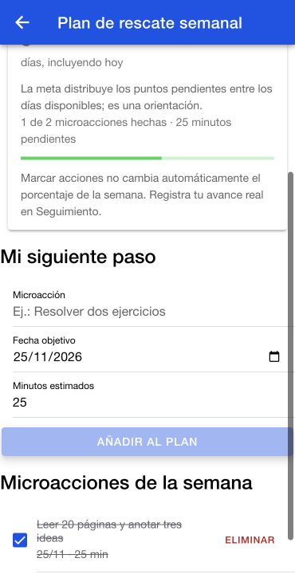

# Seguimiento de Retos

Aplicación de las guías 02, 03 y 04: Django 5.2 + DRF + MySQL 8.4, Angular 22 + Ionic 9 y Capacitor 8.

## Iniciar en macOS

En VS Code: Quick Access → **Run Task** → **Iniciar todo (Seguimiento Retos)** arranca MySQL, el backend y el frontend. También puedes hacerlo desde la raíz, en dos terminales:

```sh
./scripts/iniciar-backend.sh
```

```sh
./scripts/iniciar-frontend.sh
```

- Web: http://localhost:8100
- API: http://127.0.0.1:8000/api/
- Swagger: http://127.0.0.1:8000/api/docs/
- Administrador: http://127.0.0.1:8000/admin/
- Android: http://10.0.2.2:8000/api/

El backend escucha en 8000 y MySQL mantiene 3307. Detén cualquier otro servidor que ocupe esos puertos antes de iniciar.

## Informe de evidencias

Documento único con las Evidencias 1 a 5 y la funcionalidad propia: [documentacion/Informe_Evidencias_SeguimientoRetos.pdf](documentacion/Informe_Evidencias_SeguimientoRetos.pdf) (también en [Word](documentacion/Informe_Evidencias_SeguimientoRetos.docx)).

## Estructura

- backend/config: configuración Django.
- backend/retos: modelos Reto, Avance, TareaSemanal y Microaccion; API, calendario, administrador y pruebas.
- frontend/src/app/core: API, modelos, seguimiento RxJS y reglas del semáforo.
- frontend/src/app/paginas: lista, creación, detalle, alertas y plan de rescate.
- documentacion: guías del profesor e informes.

## Pruebas

```sh
cd backend
.venv/bin/python manage.py test retos
cd ../frontend
npm test -- --watch=false
npm run build
```

## Android

```sh
cd frontend
npm run build
npx cap sync android
npx cap open android
cd android
./gradlew assembleDebug
```

El JDK debe ser Eclipse Temurin 21. La APK queda en frontend/android/app/build/outputs/apk/debug/app-debug.apk.

Credenciales administrativas locales: `.local/django-admin.env`. Variables del backend: `backend/.env`. Ambos están excluidos de Git; nunca los adjuntes a una entrega.

El reto «Demostración de semáforos» contiene datos de prueba para mostrar los colores y el riesgo; no representa actividad real del estudiante.

## Función adicional: plan de rescate semanal

Permite transformar el trabajo pendiente de la semana en microacciones concretas con fecha objetivo, minutos estimados y una casilla de completada. Muestra los minutos pendientes, las acciones vencidas y una meta diaria sugerida: `ceil((100 - porcentaje) / días restantes incluyendo hoy)`.

Ejemplo: con 50 % pendiente y cinco días disponibles, la orientación es avanzar 10 puntos porcentuales por día. Completar microacciones no cambia el porcentaje semanal: este se registra por separado según el avance real.

Entra en un reto y pulsa **Organizar mi plan de rescate** en la semana actual. Los datos se guardan en MySQL y se comparten entre web y Android. Los planes de semanas cerradas o futuras son de solo lectura; la API impide crearlos, modificarlos o eliminarlos fuera de la semana vigente. Cada acción debe tener una fecha dentro de la semana y una duración entre 1 y 240 minutos.

### Archivos de la función

- `backend/retos/models.py` y migración `0003_microaccion.py`: almacenamiento de las microacciones.
- `backend/retos/plan_rescate.py`: reglas de apertura y cálculo de la meta diaria.
- `backend/retos/serializers.py`, `views.py`, `urls.py` y `admin.py`: validaciones, API y administración.
- `backend/retos/tests.py`: siete pruebas adicionales que conservan las cinco de la guía.
- `frontend/src/app/core/modelos.ts` y `retos-api.service.ts`: tipos y peticiones HTTP.
- `frontend/src/app/paginas/plan-rescate.page.ts`, `reto-detalle.page.ts` y `app.routes.ts`: pantalla, entrada desde cada semana y navegación.

API adicional: `GET /api/tareas/{id}/plan-rescate/` y CRUD `/api/microacciones/` (filtros por `tarea` y `completada`).



### Verificaciones del 25 de noviembre de 2026

- Backend: 12 pruebas OK (cinco de la guía y siete del plan).
- Frontend: ocho pruebas OK y compilación web sin errores.
- Android: `assembleDebug` con BUILD SUCCESSFUL; APK instalada en Retos_API_36. Comprobados carga de datos, guardado de porcentaje y alertas. La creación de microacciones desde Android quedó pendiente de verificar al detener esa revisión a petición del usuario.
- Web: comprobadas creación, búsqueda, validación de fechas, registro de avance, guardado semanal, creación y completado de microacciones, persistencia al recargar y planes de solo lectura.

Consulta [el índice de evidencias](evidencias/README.md) para los registros y capturas. Los retos y avances que comienzan por «Demo» son datos de demostración. Con el calendario configurado, el 25/11/2026 corresponde a la semana 8; los retos nuevos generan desde esa semana hasta la 15, y los anteriores conservan la semana 7.
