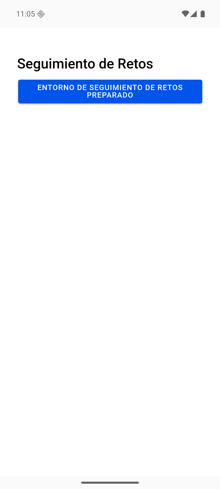

# Informe de instalación — Seguimiento de Retos

Fecha: 18 de noviembre de 2026. Equipo: macOS, Apple Silicon (arm64).

La guía suministrada es para Windows. Se adaptaron los comandos a zsh/macOS conservando versiones, puerto MySQL, estructura de proyecto y resultado de la práctica.

## Verificaciones de backend

```text
Python: 3.12.16 | Bits: 64
Entorno: /Users/antoniojoseojeda/Proyectos/SeguimientoRetos/backend/.venv/bin/python
Django: 5.2.19
Servidor, puerto, base y usuario: ('8.4.13', 3307, 'seguimiento_retos', 'retos_app@127.0.0.1')
Tablas: 0
OK: conexión Python–MySQL
No broken requirements found.
```

Se instaló una instancia independiente de MySQL 8.4, accesible solo desde este equipo en el puerto 3307 y con inicio de sesión automático mediante LaunchAgent. Se conservó el directorio anterior de MySQL. La cuenta `retos_app` tiene permisos únicamente sobre `seguimiento_retos`.

La base permanece vacía: las migraciones y el proyecto Django corresponden a la siguiente etapa. Se prepararon el entorno virtual, `.env`, `.env.example`, `requirements.txt` y `.gitignore`. Las credenciales están fuera de Git y no se incluyen en este informe.

## Versiones de frontend

```text
Node: 24.22.2
npm: 11.19.1
Angular CLI global: 22.2.6
Ionic CLI: 7.2.1
frontend@0.0.0 /Users/antoniojoseojeda/Proyectos/SeguimientoRetos/frontend
├── @angular/build@22.2.7
├── @angular/cli@22.2.7
├── @angular/common@22.2.6
├── @angular/compiler-cli@22.2.6
├── @angular/compiler@22.2.6
├── @angular/core@22.2.6
├── @angular/forms@22.2.6
├── @angular/platform-browser@22.2.6
├── @angular/router@22.2.6
├── @capacitor/android@8.6.2
├── @capacitor/cli@8.6.2
├── @capacitor/core@8.6.2
├── @ionic/angular@9.0.12
├── ionicons@8.1.0
├── jsdom@30.1.3
├── prettier@3.10.1
├── rxjs@7.8.2
├── tslib@2.9.1
├── typescript@6.0.3
└── vitest@5.1.1

```

La plantilla standalone conserva los proveedores de rutas, añade `provideIonicAngular()`, importa `IonButton` desde `@ionic/angular` y carga los estilos de Ionic. El botón «Entorno de Seguimiento de Retos preparado» se verificó visualmente en http://localhost:8100.

`npm run build` terminó correctamente y generó `dist/frontend/browser/index.html`. Las dos pruebas de Angular pasaron. `cap sync android` completó y `cap doctor` informó «Android looking great».

## Herramientas del equipo

- Git disponible, con identidad configurada.
- VS Code 1.144.0 y extensiones Python, Pylance, Angular, Prettier, ESLint e idioma español.
- Android Studio Rabbit 2 2026.2.2 Patch 1.
- OpenJDK 21.0.13.0.3, seleccionado mediante JAVA_HOME y PATH persistentes.
- ANDROID_HOME configurado; Android SDK Platform 36, Build-Tools 36.0.0, Platform-Tools, Command-line Tools y Emulator disponibles.
- Gradle 8.14.3 y Capacitor 8.6.2.

## Dificultades resueltas y observaciones

1. Se corrigió la selección de Java: el comando `java` usaba Java 8 y JAVA_HOME apuntaba a Java 25. Ahora las terminales nuevas usan Java 21. El proyecto Android incluye selección local del JDK 21 para Android Studio.
2. La prueba del apartado 5.1 contiene `port=330`; se utilizó `3307`, de acuerdo con el resto de la guía.
3. No había frontend ni repositorio Git. Se creó la plantilla Angular/Ionic y se inicializó el repositorio.
4. npm audit informó 12 alertas altas en herramientas de desarrollo y sus dependencias transitivas. No ofrece una solución compatible para todas; no se usó `--force` ni se bajó Angular a una rama distinta de la solicitada. Es una observación de dependencias, no un fallo de compilación.
5. npm bloqueó scripts de instalación de cinco dependencias; la compilación, el servidor web y las pruebas funcionaron con los paquetes disponibles. El diagnóstico de Capacitor informa esta observación.
6. La compilación Android puede advertir sobre `flatDir` y versiones XML del SDK; el resultado final de la compilación se registra abajo.

## Paso 12

Es únicamente referencia. No se necesita todavía un servidor en el puerto 8000. Las direcciones futuras son `localhost:8000/api/` para el navegador de la Mac, `10.0.2.2:8000/api/` para el emulador y `IP_LOCAL_DE_LA_MAC:8000/api/` para el teléfono.

## Referencia

[Entorno oficial de Capacitor](https://capacitorjs.com/docs/getting-started/environment-setup).

## Resultado Android y evidencias

- `./gradlew assembleDebug`: **BUILD SUCCESSFUL**, 93 tareas ejecutadas; primera compilación: 2 minutos y 47 segundos.
- APK: `frontend/android/app/build/outputs/apk/debug/app-debug.apk`.
- SHA-256: `403154b6babeaaca686d4a0d6ab4426b11b135f8e8c171a7846ebdcadc369425`.
- Emulador creado: **Retos_API_36**, imagen Google APIs arm64-v8a, teléfono Pixel 7.
- `adb devices`: `emulator-5556 device`; `ro.build.version.sdk`: `36`.
- Instalación APK: `Success`. Inicio de `edu.ejemplo.seguimientoretos/.MainActivity`: `Status: ok`.
- Botón Ionic verificado visualmente en la aplicación API 36.
- Android Studio terminó la sincronización, detectó Retos API 36 y habilitó la configuración `app`; usa JDK 21.



## Estado de los pasos 0–12

| Paso | Resultado |
| --- | --- |
| 0 | Terminal adaptada a macOS/zsh. winget y PowerShell no son necesarios en este equipo. |
| 1 | MySQL 8.4.13 en 3307; base y cuenta de aplicación verificadas. |
| 2 | Python 3.12.16, 64 bits. |
| 3 | Git, VS Code, identidad Git y extensiones disponibles. |
| 4 | Carpeta del proyecto, backend, documentación, Git y entorno virtual preparados. |
| 5 | Django 5.2.19 y dependencias, pip check, conexión MySQL, variables y requisitos comprobados. |
| 6 | Node 24.22.2 y npm disponibles. |
| 7 | Angular CLI e Ionic CLI disponibles en terminales nuevas. |
| 8 | Plantilla Angular standalone con botón Ionic funcionando en navegador. |
| 9 | Android Studio, Java 21, SDK 36, herramientas y emulador API 36 configurados. |
| 10 | Capacitor instalado, sincronización Android y APK de depuración verificadas. |
| 11 | Entorno registrado en Git con requirements.txt, package-lock.json y secretos excluidos. |
| 12 | Referencia revisada; no hay comandos pendientes en esta sección. |

## Registro Git

Commit de instalación: `a8c6ea1` — Prepara el entorno de desarrollo web y Android. Se comprobó que ningún archivo preparado contiene las contraseñas o SECRET_KEY locales.
